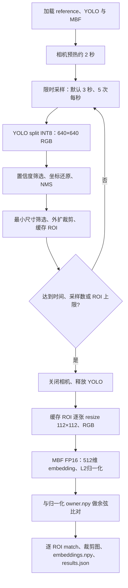

# YOLO + MobileFaceNet 板端集成总结

## 1. 当前结论与范围

RK3576 板端 C++ 两阶段人脸检测与识别链路已运行。当前组合是 YOLO11n face split INT8 检测 + InsightFace w600k_mbf FP16 embedding + 单人 reference 余弦比对。

run4 按本次测试上下文作为本人采集记录；run5 已由用户明确确认为他人。当前阈值 0.43 在这两次采集中实现了多数本人 ROI 通过、他人 ROI 全部拒绝。用户同意以当前效果继续原型集成。此结论不是多身份、多场景的识别精度认证。

用户已确认人脸部分完成原型阶段验收，并同意本文验收参数口径。验收依据为已有逐ROI结果与已测批量延迟；扩展会话统计、质量增强和会话判定仍按下文单独标记为待验证/待实现。本次仅更新文档，不修改程序参数或重新运行推理。

## 2. 管线



- C++ 入口：`../cpp_deploy/face_recognition.cpp`，CMake target 为 `face_recognition`。
- PC Python 原型：`../scripts/face_recog_pipline/Yolo_insightface_integration/webcam_yolo_mbf.py`，使用 ONNX Runtime；板端 C++ 使用 RKNN Runtime。
- 原生 V4L2 获取 NV12，按实际协商分辨率和 stride 转 BGR。默认设备 `/dev/video42`，请求 1920×1080；重启或换固件后需核实节点。
- YOLO 直接缩放至 640×640；输出为 `(1,4,8400)` boxes 与 `(1,1,8400)` scores，按查询到的形状识别输出顺序；boxes 为像素单位 cx/cy/w/h，scores 已经过 Sigmoid。
- 按原图宽高分别还原坐标，裁剪范围限制在图像内，做单类 NMS。当前仅有最小尺寸等基础过滤，未实现人脸宽高比、清晰度或姿态筛选。
- YOLO RKNN 已编码 mean=0、std=255；MBF RKNN 已编码 mean=127.5、std=128。C++ 均输入 RGB UINT8，由 RKNN 处理归一化，避免重复处理。
- MBF 输入 112×112，输出 `(1,512)`。当前动态输入模型在 C++ 初始化时通过 `rknn_set_input_shapes()` 显式选择输入形状。
- 两个模型均配置 `RKNN_NPU_CORE_0_1`；这是同一次推理使用双核，不代表跨帧流水并行。
- ROI 独立比对，不进行多人向量混合、跟踪、五点对齐、活体检测或整次会话身份决策。`match` 为逐 ROI 的阈值比较结果，不会直接控制门锁。

## 3. Reference 与录入

| 用途 | 路径 |
|---|---|
| 当前 PC reference | `face_recog/embedding_reference/owner.npy` |
| 原始 reference，保留 | `face_recog/gallery/owner.npy` |
| 板端 reference | `/home/industio/yolo_test/embedding_reference/owner.npy` |
| 录入入口 | `scripts/face_recog_pipline/Yolo_insightface_integration/enroll.py` |

当前 reference 从原 gallery 文件复制，未重新录入。Python 录入脚本默认保存到新目录；Python 识别和 C++ 默认读取对应 reference 路径。PC 重新录入后需要显式推送到板端，不会自动同步。

录入逻辑为逐 crop embedding → 向量均值 → L2 归一化 → 保存单人 `owner.npy`，并保存审计图片、逐 crop embedding 和元数据。C++ reference 读取只接受有限的 float32/float64 512维单人 NPY 格式，验证非有限值、长度及范数。

## 4. 实测与原始证据

所有下表数字来自归档 `results.json`。除单图冒烟外，阈值均为 0.43。

| 运行 | 采样帧 | ROI | 通过数 | cosine 范围 | 采集 ms | 整批识别 ms | embedding+比对累计 ms |
|---|---:|---:|---:|---|---:|---:|---:|
| 单图冒烟 | 1 | 2 | 2（阈值0，仅流程验证） | 0.0858～0.2086 | 42.01 | 15.68 | 12.20 |
| run2 | 14 | 15 | 5 | −0.0123～0.5454 | 2670.80 | 619.43 | 195.34 |
| run4（本人测试上下文） | 15 | 17 | 14 | 0.0299～0.6561 | 2911.61 | 673.23 | 215.69 |
| run5（用户确认他人） | 15 | 15 | 0 | −0.0118～0.1729 | 2879.87 | 699.01 | 209.54 |

- run4 有两个异常宽框：`face_0011` 与 `face_0013` 约1245×255，分数分别0.0299和0.0354；正常比例的15个 ROI 中14个通过，另一个 `face_0012` 为0.3653。未逐图独立标注，不能直接称作识别准确率。
- run5 他人15个 ROI 全部低于0.43。连续帧高度相关，不能将其视为15个独立身份试验，也不能据此宣称总体 FAR=0。
- 整批识别计时包含 embedding、余弦计算、PNG保存及循环内 JSON 写入，排除模型加载、采集、相机预热以及最终 report/NPY 写入。
- run2/run4/run5 的整批识别其余开销分别为424.08/457.54/489.46 ms；这些没有分项计时，不全部归为磁盘写入。
- 当前仅证明15～17个 ROI 的已测批次均小于1000 ms，不证明默认最大50个 ROI 时也满足该目标；没有跨会话 P95/P99 统计。
- 单图冒烟的阈值0不能用于识别验收。此次归档仅包括 `board_setup` 中实际存在的 smoke、run2、run4、run5，未捏造 run1/run3 数据。

原始结果在 `../benchmark_yolo_face/yolo_mbf_integrate/board_results/<run>/`，包含 `results.json`、`embeddings.npy`、`preview.jpg` 和 `face_*.png`。同一归档根目录的 `run_summary.csv` 提供汇总，`archive_manifest.json` 记录来源、大小和 SHA256。原 `D:/board_setup` 内容保留。

检测器独立 FDDB 验证结果另在 `../benchmark_yolo_face/benchmark_int8_split/results_board/summary.json`：567张图、1054个GT，Precision=0.85918、Recall=0.91461、AP50=0.90349、mAP50–95=0.32492；Python推理API均值26.21 ms。采用YOLO矩形标注与置信度0.25截断，不是FDDB官方椭圆协议，也不是C++整条识别链路的性能。

## 5. 已确认验收口径与扩展验证

### 当前运行基线（记录，不更改）

| 参数 | 当前值/含义 |
|---|---|
| cosine阈值 | CLI显式传入0.43；代码不提供解锁默认阈值 |
| YOLO conf / NMS IoU | 0.25 / 0.45 |
| duration / sample-fps | 3秒 / 5次每秒，目标15帧 |
| max-faces | 50个ROI（多脸可超过采样帧数） |
| min-face-px / margin | 40像素 / 每边外扩0.2倍框尺寸 |
| 参考向量 | 现有owner.npy，512维、归一化 |
| 识别延迟目标 | 用户既有目标：整批缓存处理≤1000 ms |

### 用户确认的参数口径（实现与验证状态分别记录）

1. **批量与延迟**：先以15～20个合格ROI为明确预算，整批识别阶段≤1000 ms。若保留50个ROI上限，需单独测50个的预算；不能沿用当前15～17个结果。建议后续采集至少30次会话并报告P50/P95，暂建议P95≤1000 ms，当前证据不足以判定。
2. **身份阈值**：暂固定0.43与当前reference，先扩充独立会话；不在run4/run5上反复调参后再把同一批数据当最终验收集。
3. **整次决策**：建议明确是“逐ROI观察”还是“单人解锁”。若要解锁，可讨论至少3个合格ROI、其中至少3个超过阈值；人数不唯一或合格样本不足时拒绝/重采。该规则尚未编码，计票不能代替身份跟踪，不能跨不同人混合票数。
4. **功能试验**：建议本人至少20次独立触发、至少5位他人各10次独立触发，覆盖距离、姿态和光照；可先约定本人会话通过率≥95%、该轮他人测试零放行。该样本规模只能作为原型功能门槛，不能证明低FAR或生产安全等级。
5. **ROI质量**：建议讨论最小边60像素、宽高比区间0.6～1.5并排除异常宽框；需回看本人ROI验证召回后再定，暂不修改代码。质量参数不能仅按检测置信度替代。
6. **故障兜底**：建议相机/模型异常、无人脸、reference无效或样本不足时一律不放行，并记录失败原因。现有程序部分异常返回错误、无人脸记录零缓存；尚无门锁控制与完整会话状态机。

确认结论：当前人脸原型阶段验收完成，阈值固定0.43，批量预算采用≤20个合格ROI、整批识别≤1000ms。已测15～17个ROI满足该目标；20个ROI专项验证、30次独立会话P95统计及多人身份扩展测试尚未完成。上述质量增强、会话判定与兜底作为后续认可的设计/验证口径，尚未编码；当前功能边界仍为逐ROI匹配。代码默认max-faces仍为50，验收预算不等于代码默认值已修改。

## 6. 构建与运行

板端工作目录 `/home/industio/yolo_test`，源码 `cpp/`，可执行文件 `cpp/build/face_recognition`。

```powershell
$adb = "D:\yolo_rk3576_deploy\rk3576_setup\ADB工具\adb_win\adb.exe"
$serial = "a91e50ace81c0155"  # 重新烧录/重连后先用 adb devices 核对
& $adb -s $serial shell cmake -S /home/industio/yolo_test/cpp -B /home/industio/yolo_test/cpp/build -DCMAKE_BUILD_TYPE=Release
& $adb -s $serial shell cmake --build /home/industio/yolo_test/cpp/build --target face_recognition -j2
& $adb -s $serial shell /home/industio/yolo_test/cpp/build/face_recognition --check-only
# 输出目录必须尚不存在；以下仅为复现模板，不在本次整理中执行。
& $adb -s $serial shell /home/industio/yolo_test/cpp/build/face_recognition --threshold 0.43 --output /home/industio/yolo_test/results/face_recog_next
```

## 7. 相关文件夹树

下列为相关路径摘录；完整选定文件树见 `../benchmark_yolo_face/yolo_mbf_integrate/related_tree.txt`，不列无关工程、缓存或逐张图片。本文位于 `docs/yolo_face_SUMMARY.md`。

```text
yolo_rk3576_deploy/
├── cpp_deploy/
│   ├── CMakeLists.txt
│   ├── face_recognition.cpp                 # 板端分阶段推理入口
│   └── camera_yolo11_face_int8.cpp          # 独立检测/显示程序
├── scripts/
│   ├── face_recog_pipline/Yolo_insightface_integration/
│   │   ├── webcam_yolo_mbf.py               # PC ONNX原型
│   │   ├── enroll.py                        # reference录入
│   │   └── probe_camera.py
│   ├── InsightPTQ/
│   │   ├── rknn_mbf_convert.py
│   │   └── output_fp16/w600k_mbf_rk3576_fp16.rknn
│   └── YOLO11_face_PTQ/rknn_yolo11_ptq.py
├── models/
│   ├── insightface/w600k_mbf.onnx
│   └── yolov11n/
│       ├── yolo_face/yolo11n_face_split.onnx
│       └── rknn/yolo11n_face_split_int8.rknn
├── face_recog/
│   ├── embedding_reference/owner.npy        # 当前统一reference
│   └── gallery/owner.npy                    # 保留原始文件
└── benchmark_yolo_face/
    ├── benchmark_fp16/                      # 原FP16检测评测
    ├── benchmark_int8_split/
    │   ├── benchmark_fddb_rknn_split.py
    │   └── results_board/                   # 检测器FDDB结果
    └── yolo_mbf_integrate/

        ├── related_tree.txt
        ├── run_summary.csv
        ├── archive_manifest.json
        └── board_results/
            ├── face_cpp_smoke_fixed/
            ├── face_recog_run2/
            ├── face_recog_run4/
            └── face_recog_run5/
                # 每个运行目录保留实际原始JSON、NPY、预览和ROI图片
```

外部数据集在 `D:/face_train/datasets/fddb_yolo`，不属于本工作区目录树。依赖安装包、下载缓存等 `D:/board_setup` 内容不混入推理 benchmark。
